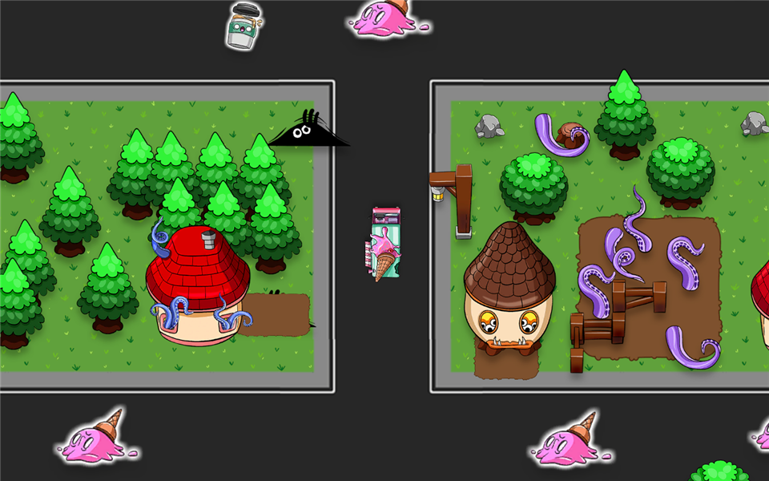

# 🚚 Delivery Dash

**One package at a time. Mind the boost pads.**

A top-down 2D driving game built in Unity 6, and the first thing I ever shipped
with the engine.

---

## The idea

Drive around a small town, grab a package, find the customer who wants it, repeat.
You can only carry one at a time, so the whole game is route planning at speed.
Boost pads make the van quicker and sharper until the next time you hit something.

> **▶ [Play it in your browser](https://artsiom-beep.github.io/delivery-dash/)** — no
> install, no plugin. Replace this link with your own GitHub Pages URL after you
> enable Pages (Settings → Pages → Branch `main`, folder `/docs`).

## Controls

| Key     | Action                 |
| ------- | ---------------------- |
| `W` `S` | Drive forward and back |
| `A` `D` | Steer                  |

## Under the hood

The code lives in [`Assets/Scripts`](Assets/Scripts) and is deliberately plain.

### Driving

[`Driver.cs`](Assets/Scripts/Driver.cs) reads the keyboard through the Input System
and moves the van with `Translate` and `Rotate`, both scaled by `Time.deltaTime`.
Speed and steering rate are separate serialized fields, so the handling is tuned
in the inspector rather than in code. A boost pad raises both and shows an
on-screen label. Any collision restores the stored normal values and hides it.

### Deliveries

[`Delievery.cs`](Assets/Scripts/Delievery.cs) holds the carry-one rule. Trigger
checks are tag-based and the `hasPackage` flag guards both directions, so you
cannot pick up a second package or deliver one you are not carrying. A particle
system runs while a package is on board. On reaching the target count it reveals
the win text and freezes the game through `Time.timeScale`, with a restart that
reloads the active scene.

### Learning aid

[`Trigger.cs`](Assets/Scripts/Trigger.cs) just logs enter and exit events. It is
how I worked out Unity's 2D trigger callbacks, kept here honestly.

## What I would change now

The boost reset fires on any collision rather than only meaningful ones, and the
delivery state would read better as a small state machine than a boolean flag.
My next project, [Snow Surfer](https://github.com/Artsiom-beep/snow-surfer), is
where I fixed both.

## Timeline

Built across late August and early September 2026, my first time in the engine.

| Date | What landed |
| --- | --- |
| 22 Aug 2026 | Project created, packages set up |
| 24 Aug 2026 | First script, a trigger logger written while learning the callbacks |
| 1 Sep 2026 | Driving, package pickup and delivery, customer and boost prefabs, level built out |
| 1 Sep 2026 | Desktop build, then the first WebGL build |
| 21 Oct 2026 | Repository prepared, documented and published |

Dates come from file timestamps in the project, so they mark when each piece was
last touched rather than when it was first sketched.

## Built with

| | |
| --- | --- |
| Engine | Unity **6000.3.22f1** |
| Language | C# |
| Packages | Input System, Universal Render Pipeline, TextMesh Pro |
| Target | WebGL, served from [`docs/`](docs/) |

Open the folder in Unity Hub and load `Assets/Scenes/SampleScene.unity`.

## Credits

Art is the GameDev.tv Delivery Dash pack, used under the GameDev.tv Asset License
Agreement included in that asset folder. The game code in `Assets/Scripts` is
mine, released under the [MIT license](LICENSE).
